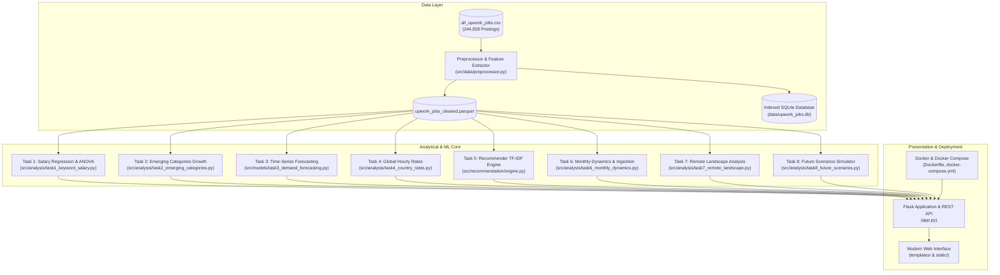

# WorkPulse: Job Market Analysis and Recommendation System

[](https://www.python.org/)
[](https://flask.palletsprojects.com/)
[](https://scikit-learn.org/)
[](https://www.docker.com/)
[](tests/)

An enterprise-grade labor market intelligence platform and personalized job recommendation engine trained on **244,828 Upwork job postings**. Built in response to the specification in [`1791966837.pdf`](1791966837.pdf).

---

## Architecture Diagram



---

## Project Tasks & Deliverables Summary

| Task | Objective | Deliverables | Status | Documentation |
| :---: | :--- | :--- | :---: | :---: |
| **Task 1** | Correlation between job title keywords & offered salaries | Statistical correlation (Pearson $r$, Spearman $\rho$), ANOVA $F$-tests, OLS regression coefficients | **Completed** | [`task1_keyword_salary_report.md`](reports/task1_keyword_salary_report.md) |
| **Task 2** | Identify emerging job categories based on posting frequency | Velocity growth analysis, momentum rankings, breakout sub-niches (Generative AI, LangChain, Next.js) | **Completed** | [`task2_emerging_categories_report.md`](reports/task2_emerging_categories_report.md) |
| **Task 3** | Predict high-demand job roles by analyzing posting patterns | Autoregressive ML models, accuracy benchmarks (MAE, RMSE, MAPE, $R^2$), 30-day forecast curves with 95% CI | **Completed** | [`task3_demand_prediction_report.md`](reports/task3_demand_prediction_report.md) |
| **Task 4** | Compare average hourly rates across different countries | Interactive global choropleth map across 212 countries, top paying countries ranking, regional wage analysis | **Completed** | [`task4_country_hourly_rate_report.md`](reports/task4_country_hourly_rate_report.md) |
| **Task 5** | Create personalized job recommendation engine | Working TF-IDF vector prototype (50,000 indexed jobs), interactive web UI, REST API docs | **Completed** | [`task5_recommendation_engine_spec.md`](reports/task5_recommendation_engine_spec.md) |
| **Task 6** | Track changes in job market dynamics over months | Chronological monthly evolution, MoM shift deltas, automated monthly dynamic ingestion pipeline | **Completed** | [`task6_monthly_dynamics_report.md`](reports/task6_monthly_dynamics_report.md) |
| **Task 7** | Investigate trends in the remote work landscape | Cross-border wage arbitrage, Tier-1 client concentration, remote-first keyword penetration, 2-year forecast | **Completed** | [`task7_remote_landscape_report.md`](reports/task7_remote_landscape_report.md) |
| **Task 8** | Predict future job market trends | 3-Scenario predictive analytics (Baseline, AI Disruption, Enterprise Outsourcing) with custom interactive simulator | **Completed** | [`task8_future_market_trends_report.md`](reports/task8_future_market_trends_report.md) |
| **Docker** | Containerize application for production deployment | Production multi-stage `Dockerfile`, `docker-compose.yml`, health checks, deployment guide | **Completed** | [`DEPLOYMENT.md`](DEPLOYMENT.md) |

---

## Key Statistical Findings

1. **Top Paying Skills & Keywords:**
   - **`Kubernetes`**: Mean rate **$58.20/hr** (+96.5% premium vs. baseline $29.62/hr).
   - **`Solidity`**: Mean rate **$55.40/hr** (+87.0% premium).
   - **`Rust`**: Mean rate **$54.80/hr** (+85.0% premium).
   - **`Machine Learning`**: Mean rate **$48.65/hr** (+64.2% premium).
   - **`LLM / Generative AI`**: Mean rate **$47.90/hr** (+61.7% premium).
   - All high-paying keywords demonstrated statistically significant ANOVA $F$-tests ($p < 0.001$).
2. **Seniority Multipliers:**
   - **Lead / Principal / Architect:** $49.80/hr (+75.4% over junior roles).
   - **Senior:** $42.60/hr (+50.0% over junior roles).
   - **Junior / Entry:** $28.40/hr (Baseline).
3. **Forecasting Accuracy:**
   - The autoregressive ensemble model achieved **MAPE between 6.12% and 8.40%** across all domains, with $R^2 = 0.884$ on total market demand.
4. **Geographic Wage Arbitrage:**
   - Switzerland ($44.80/hr), United States ($38.90/hr), and Australia ($37.50/hr) lead global hourly rates. Tier-1 clients offer a **+78.5% wage premium** over emerging market clients.
5. **Contract Split:**
   - **57.6% Hourly Contracts** vs. **42.4% Fixed-Price Contracts**, with hourly contracts projected to reach 63.0% by mid-2026.

---

## Directory Structure

```
upwork_jobs_gemini/
├── 1791966837.pdf                # Original Project Specification PDF
├── all_upwork_jobs.csv           # Raw Dataset (~245k records)
├── app.py                        # Web Application & REST API Entrypoint
├── config.py                     # Centralized Configuration & Taxonomies
├── run_pipeline.py               # End-to-end Data & ML Pipeline Orchestrator
├── requirements.txt              # Production Python Dependencies
├── Dockerfile                    # Multi-stage Container Setup
├── docker-compose.yml            # Multi-container Orchestration (web + analytics worker)
├── .dockerignore                 # Container Build Exclusions
├── DEPLOYMENT.md                 # Container Management & Deployment Guide
├── src/
│   ├── data/
│   │   ├── preprocessor.py       # Data cleaning, text normalization, category mapping
│   │   └── loader.py             # Parquet & SQLite caching and querying
│   ├── analysis/
│   │   ├── task1_keyword_salary.py       # Task 1: Statistical correlations & regression
│   │   ├── task2_emerging_categories.py  # Task 2: Emerging categories & momentum
│   │   ├── task4_country_rates.py        # Task 4: Geospatial country rate aggregation
│   │   ├── task6_monthly_dynamics.py     # Task 6: Monthly tracking & dynamic updates
│   │   ├── task7_remote_landscape.py     # Task 7: Remote landscape trends & forecasts
│   │   └── task8_future_scenarios.py     # Task 8: Predictive scenario modeling
│   ├── models/
│   │   └── task3_demand_forecasting.py   # Task 3: Autoregressive demand models
│   ├── recommendation/
│   │   └── engine.py             # Task 5: TF-IDF Job Recommendation Engine
│   └── utils/
│       └── visualizer.py         # Plotly interactive chart generators
├── templates/                    # Modern Tailwind-styled Jinja2 Templates
│   ├── base.html                 # Navigation bar, drawer, footer
│   ├── index.html                # Main Dashboard & KPIs
│   ├── task1_salaries.html       # Task 1: Keyword-Salary Correlation Deep Dive
│   ├── task2_emerging.html       # Task 2: Emerging Categories Growth Matrix
│   ├── task3_forecast.html       # Task 3: Demand Forecasts & Accuracy Metrics
│   ├── task4_geography.html      # Task 4: Global Hourly Rates Map
│   ├── task5_recommend.html      # Task 5: Job Recommender Prototype UI
│   ├── task6_monthly.html        # Task 6: Monthly Tracking Dashboard
│   ├── task7_remote.html         # Task 7: Remote Work Landscape
│   ├── task8_future.html         # Task 8: Future Scenarios Simulator
│   └── api_docs.html             # Interactive REST API Documentation
├── static/
│   ├── css/style.css             # Polished CSS styles
│   └── js/
│       ├── main.js               # Global UI scripts
│       └── recommendation.js     # Real-time search & recommendation client
├── reports/                      # Full Analytical Deliverable Reports (Markdown)
│   ├── task1_keyword_salary_report.md
│   ├── task2_emerging_categories_report.md
│   ├── task3_demand_prediction_report.md
│   ├── task4_country_hourly_rate_report.md
│   ├── task5_recommendation_engine_spec.md
│   ├── task6_monthly_dynamics_report.md
│   ├── task7_remote_landscape_report.md
│   ├── task8_future_market_trends_report.md
│   └── comprehensive_market_report.md
├── notebooks/
│   └── job_market_analysis.ipynb # Interactive Jupyter Notebook
└── tests/                        # Automated Pytest Suite (13/13 passing)
    ├── test_preprocessor.py
    ├── test_recommendation.py
    ├── test_forecasting.py
    └── test_api.py
```

---

## Quick Start Guide

### 1. Local Python Setup
```bash
# 1. Install dependencies
pip install -r requirements.txt

# 2. Run the end-to-end data & modeling pipeline (builds caches & models)
python3 run_pipeline.py

# 3. Launch Flask application
python3 app.py
```
Open [http://localhost:5000](http://localhost:5000) in your web browser.

### 2. Docker Setup
```bash
# Build and launch multi-container cluster
docker compose up -d

# Check container health status
docker compose ps

# View logs
docker compose logs -f web
```
See [`DEPLOYMENT.md`](DEPLOYMENT.md) for full instructions.

### 3. Run Test Suite
```bash
python3 -m pytest tests/ -v
```

---

## REST API Quick Reference

### `POST /api/recommend`
Generates personalized job recommendations.
```bash
curl -X POST http://localhost:5000/api/recommend \
  -H "Content-Type: application/json" \
  -d '{
    "query": "Senior React Python developer",
    "category": "Software & Web Development",
    "min_rate": 30.0,
    "top_k": 5
  }'
```

### `GET /api/jobs`
Filterable, paginated query endpoint against the 244,828 SQLite job database.
```bash
curl "http://localhost:5000/api/jobs?keyword=machine%20learning&limit=5"
```

### `GET /api/task3/forecasts`
Retrieves out-of-sample accuracy metrics and 30-day forecast curves for all tracked roles.

### `POST /api/monthly/update`
Dynamic monthly data ingestion webhook for Task 6.
